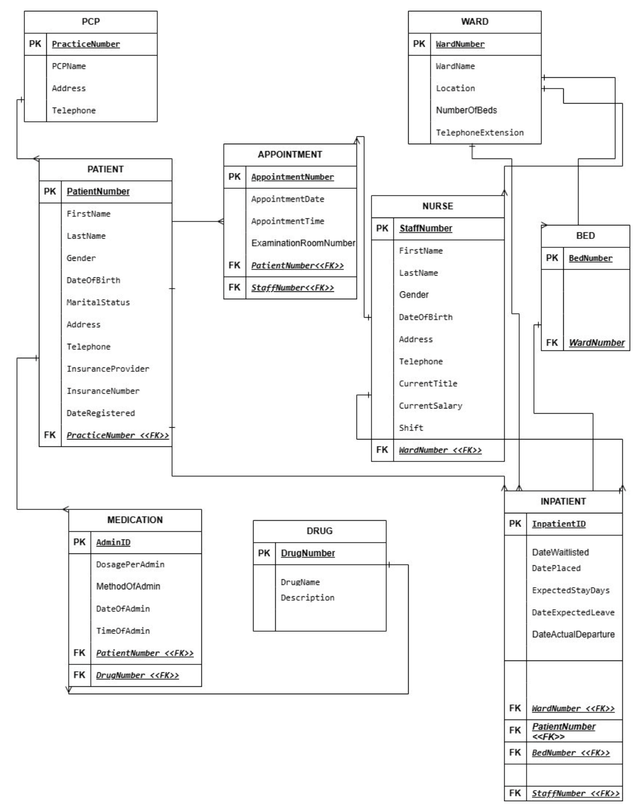
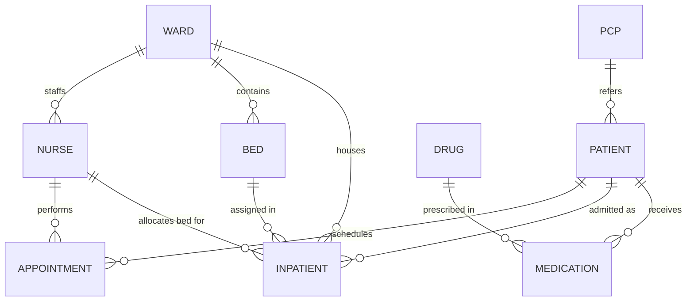

# KO_MED Hospital Database

Relational database for the inpatient side of a geriatric care hospital
(patients aged 60+), built in SQL Server. The project goes from requirements to a
working database: entities and relationships, an ER diagram, normalization from
UNF to 3NF, then the T-SQL to build, load and test it.

Author: Sumit Kashid

## Schema

Nine tables, all in 3NF:

| Table | Purpose |
|---|---|
| WARD | Wards, location, bed count, phone extension |
| BED | Beds and the ward each belongs to |
| NURSE | Staff, title, salary, shift (A/B/C), assigned ward |
| PCP | Referring primary care physicians |
| PATIENT | Registration, insurance, referring PCP |
| APPOINTMENT | Examination appointments by patient and nurse |
| INPATIENT | Waitlist, bed placement, expected and actual departure |
| DRUG | Drug catalog |
| MEDICATION | Each drug administration to a patient |

## Design notes

- The raw case data (patient assignment and medication sheets) had repeating
  drug entries in one cell, no primary key and mixed entities. Normalization
  splits it into the tables above. The full walkthrough is in
  [docs/database_design.pdf](docs/database_design.pdf).
- DRUG is kept separate from MEDICATION so drug details aren't repeated for
  every administration.
- A patient can have several INPATIENT rows to cover readmissions.
- CHECK constraints enforce gender, shift, marital status and route of
  administration (Oral or IV).

## Scripts

| File | What it does |
|---|---|
| `sql/00_create_database.sql` | Creates the `KO_MED_Hospital` database |
| `sql/01_schema_and_seed.sql` | Drops and recreates all tables with keys and constraints, loads sample data, prints row counts |
| `sql/02_transactions_and_trigger.sql` | Admits a new patient across every table, updates their bed, creates the bed conflict trigger and tests it |

### Bed conflict trigger

`trg_PreventDuplicateBedAssignment` is an `INSTEAD OF INSERT` trigger on
INPATIENT. If the requested bed already has a patient who has been placed and
not yet discharged, the insert is rejected with an error. Otherwise the row
goes through. The script tests both cases: assigning occupied bed B07 fails,
and assigning free bed B05 succeeds.

## Run it

In SQL Server Management Studio or Azure Data Studio, run the three scripts in
order. `01` can be rerun at any time to reset the data.

All patient, staff and physician records are made up.

## Tools

SQL Server (T-SQL), draw.io for the ER diagram
